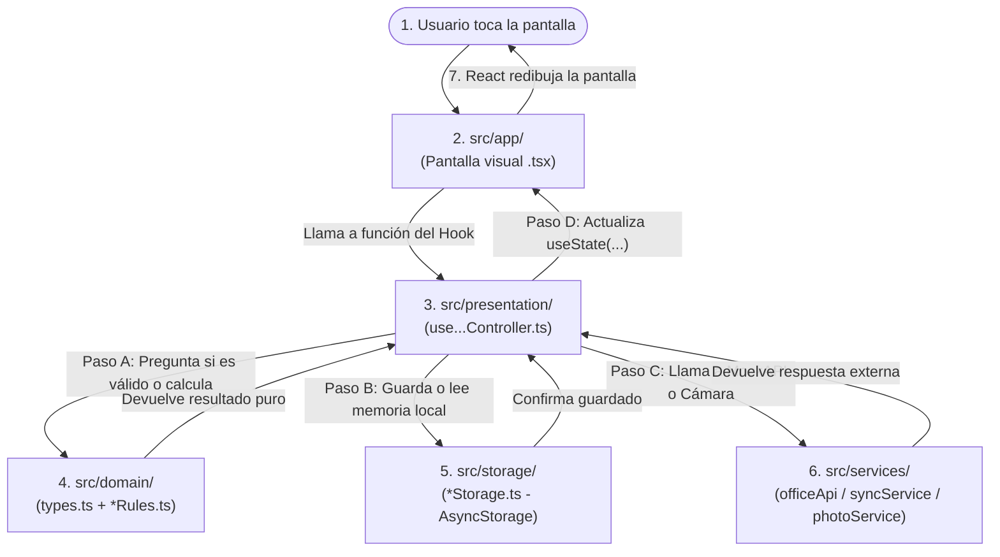
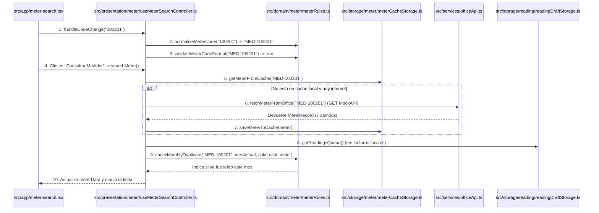
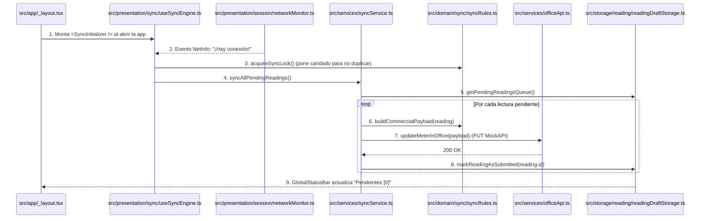

# Guía del Flujo de una Acción del Usuario a través de Todas las Capas y Carpetas

Este documento explica **el recorrido exacto que sigue la aplicación desde que el técnico toca un botón en la pantalla hasta que el dato se valida, se guarda en el teléfono, se envía a MockAPI y regresa a la vista**, indicando **qué carpeta y qué archivo entra en acción en cada milisegundo**.

---

## 1. El Mapa General: ¿En qué orden se llaman las carpetas?

Una regla de oro de esta arquitectura es que **las pantallas (`src/app/`) nunca llaman directo a la base de datos (`src/storage/`) ni a internet (`src/services/`)**. Todo viaje sigue siempre este orden:

### Resumen del rol de cada carpeta en el viaje:
| Orden | Carpeta | Rol en el flujo | ¿A quién puede llamar? |
| :--- | :--- | :--- | :--- |
| **1º** | **[`src/app/`](../src/app)** | **La Vista:** Dibuja botones, textos y estilos usando [`src/constants/theme.ts`](../src/constants/theme.ts) y [`src/components/GlobalStatusBar.tsx`](../src/components/GlobalStatusBar.tsx). | Solo a `src/presentation/` (y funciones de formato de `src/domain/`). |
| **2º** | **[`src/presentation/`](../src/presentation)** | **El Coordinador (Hook):** Recibe el clic de `app/`, consulta a `domain/`, manda a guardar en `storage/` o `services/` y actualiza los `useState`. | A `src/domain/`, `src/storage/` y `src/services/`. |
| **3º** | **[`src/domain/`](../src/domain)** | **El Juez / Calculador:** Valida formatos, calcula consumos y decide si algo es obligatorio o está bloqueado. | **A nadie externo** (es 100% puro). |
| **4º** | **[`src/storage/`](../src/storage)** | **La Memoria Interna:** Lee y escribe JSON en `AsyncStorage` del teléfono. | Solo a `AsyncStorage` y moldes `types.ts` de `domain/`. |
| **5º** | **[`src/services/`](../src/services)** | **El Mensajero Externo:** Habla con MockAPI (`Axios`), abre la cámara (`expo-image-picker`) o guarda fotos en disco (`expo-file-system`). | A librerías externas, `src/domain/` y `src/storage/`. |

---

## 2. Recorrido Paso a Paso de las 4 Acciones Principales

A continuación tienes el paso a paso exacto, archivo por archivo, de lo que ocurre en las 4 acciones clave de la aplicación:

---

### Acción 1: El técnico escribe su código y toca «Iniciar Turno»

1. **`src/app/login.tsx` (La Pantalla):**
   - El técnico escribe `TEC-001` y `1234`, y toca el botón **"Iniciar Turno"**.
   - El botón ejecuta `handleLogin()`, que llama a `await login(employeeCode, pin)` proveniente del hook de `presentation`.
2. **`src/presentation/session/useSessionController.ts` (El Coordinador):**
   - Recibe `('TEC-001', '1234')` en su función `login()`.
   - Antes de guardar nada, **consulta al Dominio** llamando a `authenticateTechnician(employeeCode, pin)`.
3. **`src/domain/session/sessionRules.ts` + `types.ts` (El Dominio):**
   - `sanitizeEmployeeCode` limpia espacios.
   - `validateCredentialsFormat` revisa que no estén vacíos.
   - `authenticateTechnician` busca en `DEFAULT_TECHNICIANS_CATALOG` si `TEC-001` coincide con `1234`.
   - Devuelve al coordinador el objeto `{ success: true, technician: { employeeCode: 'TEC-001', name: 'Carlos Mendoza' } }` respetando el molde de [`src/domain/session/types.ts`](../src/domain/session/types.ts).
4. **`src/storage/session/sessionStorage.ts` (El Almacenamiento Local):**
   - Al ver que `result.success` es `true`, el coordinador llama a `await saveSession(result.technician)`.
   - `sessionStorage.ts` convierte el objeto a JSON y lo guarda físicamente en el teléfono con `AsyncStorage.setItem('epmaps_active_session', serialized)`.
5. **Regreso a `src/presentation/` y salto en `src/app/`:**
   - `useSessionController.ts` actualiza `setActiveSession(result.technician)` y devuelve `true`.
   - [`src/app/login.tsx`](../src/app/login.tsx) recibe `true` y ejecuta `router.replace('/home')`, llevando al técnico a [`src/app/home.tsx`](../src/app/home.tsx).

---

### Acción 2: El técnico escribe `100201` y toca «Consultar Medidor»

1. **Mientras escribe (`src/app/meter-search.tsx` $\rightarrow$ `src/presentation/meter/useMeterSearchController.ts` $\rightarrow$ `src/domain/meter/meterRules.ts`):**
   - Cada tecla llama a `handleCodeChange(text)` en [`useMeterSearchController.ts`](../src/presentation/meter/useMeterSearchController.ts).
   - Este llama a `normalizeMeterCode` y `validateMeterCodeFormat` en [`meterRules.ts`](../src/domain/meter/meterRules.ts).
   - Transforma `100201` en `MED-100201` y activa el botón **"Consultar Medidor"** (`isValidCode = true`).
2. **Al tocar «Consultar Medidor» (`searchMeter()` en `useMeterSearchController.ts`):**
   - **Primero va a `src/storage/`:** Llama a `getMeterFromCache('MED-100201')` en [`meterCacheStorage.ts`](../src/storage/meter/meterCacheStorage.ts).
   - **Si no está en caché, va a `src/services/`:** Llama a `fetchMeterFromOffice('MED-100201')` en [`officeApi.ts`](../src/services/officeApi.ts), que usa `Axios` para hacer `GET /medidores` en MockAPI y normaliza los 7 campos al molde `MeterRecord` ([`src/domain/meter/types.ts`](../src/domain/meter/types.ts)).
   - **Guarda en `src/storage/`:** Apenas llega de MockAPI, llama a `saveMeterToCache(remoteMeter)` en [`meterCacheStorage.ts`](../src/storage/meter/meterCacheStorage.ts) para no volver a descargarlo en toda la jornada.
3. **Verificación de duplicado mensual (`src/storage/` + `src/domain/`):**
   - El controlador pide la lista de lecturas guardadas en el teléfono (`getReadingsQueue()` en [`readingDraftStorage.ts`](../src/storage/reading/readingDraftStorage.ts)).
   - Envía esa lista junto con el medidor a `checkMonthlyDuplicate(...)` en [`meterRules.ts`](../src/domain/meter/meterRules.ts).
4. **Regreso a `src/app/meter-search.tsx`:**
   - La pantalla recibe `meterData`, traduce el estado con `formatMeterStatusLabel(meterData.status)` de [`meterRules.ts`](../src/domain/meter/meterRules.ts) y muestra los 7 campos junto con el botón **"Registrar Nueva Lectura"**.

---

### Acción 3: El técnico captura una lectura en los 3 pasos, toma foto y guarda

1. **Entrada a la pantalla (`src/app/reading-wizard.tsx`):**
   - Recibe por parámetros de ruta (`useLocalSearchParams`) el `meterCode`, `previousReading` y `averageConsumption`, y se los entrega a [`useReadingWizardController.ts`](../src/presentation/reading/useReadingWizardController.ts).
2. **Paso 1 y Paso 2 – Cálculos en vivo con `src/domain/`:**
   - Cuando el técnico escribe la lectura actual (ej. `1350`), [`useReadingWizardController.ts`](../src/presentation/reading/useReadingWizardController.ts) llama en tiempo real a [`src/domain/reading/readingRules.ts`](../src/domain/reading/readingRules.ts):
     - `calculateConsumption(1350, 1250)` $\rightarrow$ calcula `100 m³`.
     - `checkConsumptionAnomaly(100, 18)` $\rightarrow$ detecta que `100 > (18 * 3)` y devuelve `isAnomaly = true`.
     - `getStepRequirements('NORMAL', true)` $\rightarrow$ dictamina que ahora `photoRequired = true` y exige confirmar la casilla de anomalía.
3. **Autoguardado de borrador en cada toque con `src/storage/`:**
   - Un `useEffect` dentro de [`useReadingWizardController.ts`](../src/presentation/reading/useReadingWizardController.ts) detecta cualquier cambio en `draft` y llama automáticamente a `saveDraft(draft)` en [`src/storage/reading/readingDraftStorage.ts`](../src/storage/reading/readingDraftStorage.ts) (`AsyncStorage`).
4. **Paso 3 – Tomar fotografía con `src/services/photo/`:**
   - Cuando el técnico toca **"Tomar Fotografía"**, `useReadingWizardController.ts` llama a `handleCapturePhoto()`:
     - Primero invoca `takeMeterPhoto()` en [`src/services/photo/cameraService.ts`](../src/services/photo/cameraService.ts) (que usa `expo-image-picker` para abrir la cámara física).
     - Segundo, toma la foto temporal devuelta por la cámara y llama a `persistPhoto(tempUri, meterCode)` en [`src/services/photo/photoStorageService.ts`](../src/services/photo/photoStorageService.ts) (que usa `expo-file-system` para copiar el `.jpg` a la carpeta permanente `epmaps_photos/`).
     - Guarda esa ruta permanente en `draft.photoUri`.
5. **Tocar «Finalizar y Guardar» (`submitReading()` en `useReadingWizardController.ts`):**
   - Valida por última vez los 3 pasos con `validateStepCompletion` ([`readingRules.ts`](../src/domain/reading/readingRules.ts)).
   - Construye el objeto final `ConsolidatedReading` ([`src/domain/reading/types.ts`](../src/domain/reading/types.ts)).
   - Llama a `saveConsolidatedReading(reading)` en [`src/storage/reading/readingDraftStorage.ts`](../src/storage/reading/readingDraftStorage.ts) para meterlo en la cola local `'epmaps_readings_queue'`.
   - Llama a `clearDraft()` para borrar el borrador temporal y regresa a `/home`.

---

### Acción 4: El teléfono detecta internet y envía la lectura sola a MockAPI

Este flujo ocurre **sin que el usuario toque nada**, gracias al vigilante montado en [`src/app/_layout.tsx`](../src/app/_layout.tsx):

1. **Detección en `src/app/_layout.tsx` $\rightarrow$ `src/presentation/sync/useSyncEngine.ts`:**
   - [`_layout.tsx`](../src/app/_layout.tsx) mantiene vivo a `useSyncEngine()`.
   - [`networkMonitor.ts`](../src/presentation/session/networkMonitor.ts) (`NetInfo`) avisa que hay señal de internet.
2. **Orquestación en `src/services/syncService.ts`:**
   - `useSyncEngine.ts` adquiere el candado (`acquireSyncLock` de [`src/domain/sync/syncRules.ts`](../src/domain/sync/syncRules.ts)) y llama a `syncAllPendingReadings()` en [`syncService.ts`](../src/services/syncService.ts).
   - `syncService.ts` pide las lecturas pendientes a [`readingDraftStorage.ts`](../src/storage/reading/readingDraftStorage.ts) (`src/storage/`).
3. **Evaluación y Armado del Payload con `src/domain/sync/syncRules.ts`:**
   - Si una lectura estaba en `PENDING_VERIFICATION` (capturada sin señal), primero descarga el medidor con [`officeApi.ts`](../src/services/officeApi.ts) y le pide a `evaluateDeferredReading(reading, officeMeter)` en [`syncRules.ts`](../src/domain/sync/syncRules.ts) que verifique si el consumo es normal o anómalo.
   - Si es apta para enviarse, llama a `buildCommercialPayload(reading)` en [`syncRules.ts`](../src/domain/sync/syncRules.ts), que arma el paquete comercial con su clave de idempotencia `clientReadingId`.
4. **Envío HTTP en `src/services/officeApi.ts` y cierre en `src/storage/`:**
   - `syncService.ts` envía el paquete a MockAPI mediante `updateMeterInOffice(payload)` en [`officeApi.ts`](../src/services/officeApi.ts) (`PUT /medidores/:id`).
   - Cuando MockAPI responde con éxito, `syncService.ts` llama a `markReadingAsSubmitted(reading.id)` en [`readingDraftStorage.ts`](../src/storage/reading/readingDraftStorage.ts) (`src/storage/`) cambiando el estado a **`SUBMITTED` (*Enviada*)** y actualizando también el caché local del medidor ([`meterCacheStorage.ts`](../src/storage/meter/meterCacheStorage.ts)).
5. **Reflejo automático en [`src/components/GlobalStatusBar.tsx`](../src/components/GlobalStatusBar.tsx):**
   - La barra superior ([`useGlobalStatusController.ts`](../src/presentation/session/useGlobalStatusController.ts)) detecta que la cola pendiente bajó a `0` y actualiza el contador superior derecho a **`Pendientes [0]`** en todas las pantallas.

